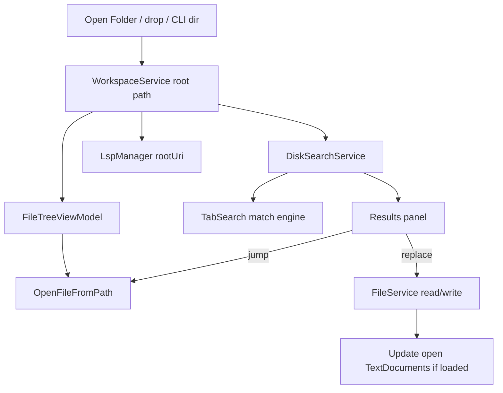

# 0.4 Design sketch: workspace + disk search

Status: **approved** (approach B: lite workspace + LSP root).

## Intent

Make x-pad usable as a small-folder daily driver: open a directory, browse files, and find/replace on disk without becoming a full IDE. Build on 0.3’s in-memory `TabSearch` and keep the one-`TextDocument`-per-tab model.

**Assumptions (correct if wrong):**

- You open a repo or notes folder often, not only single files.
- A file tree + disk search matters more than git, multi-cursor, or hex.
- One folder at a time is enough for 0.4 (no multi-root workspace file yet).

**Success:**

- File → Open Folder / drop a folder / `xpad path\to\dir` opens a workspace.
- Sidebar tree lists files; click opens a tab (existing open path).
- Find in Folder reuses search options from Find in Open Tabs; replace updates on-disk files (and open tabs if already loaded).
- LSP `rootUri` uses the opened folder when set.
- Missing LSP / huge trees degrade with a status message; no crash.

## Recommended approach

**Lite workspace + LSP root retarget** (recommended).

| Approach | Includes | Trade-off |
| --- | --- | --- |
| A. Tree only | Open folder + file tree + open on click | Disk search still missing — half the goal |
| **B. Lite + LSP root (recommended)** | A + Find/Replace in Folder + `LspManager` uses workspace root | Right size for one minor release |
| C. + workspace file | B + `.xpad-workspace` / remember last folder in session | Useful, but can follow in 0.4.1 |

Defer: multi-root, `.gitignore`-aware ignore UI prefs beyond a simple exclude list, git gutter, project-wide rename via LSP.

## Architecture

### New / changed pieces

| Piece | Role |
| --- | --- |
| `Services/WorkspaceService.cs` | Current root path; recent folders; raise `Changed` |
| `Services/DiskSearch.cs` | Enumerate text-ish files under root; stream matches via `TabSearch`; optional replace |
| `ViewModels/FileTreeViewModel.cs` | Lazy directory nodes; filter; open command |
| `Views/FileTreePanel.axaml` | Left sidebar (collapsible); reuse Fluent chrome |
| `Views/FindInFolderWindow.axaml` | Same options as Find in Open Tabs + path scope |
| `Services/Lsp/LspManager.cs` | Prefer `WorkspaceService.Root` over file’s parent directory; `ResetAsync` on folder change |
| `Services/CliArgs.cs` | Accept existing directories as “open folder” |
| `Models/AppSettings.cs` | `LastWorkspacePath`, exclude globs (e.g. `node_modules`, `.git`, `bin`, `obj`) |
| `SessionService` | Optional: restore last workspace root (Approach C lite) |

Keep replace policy safe:

1. Prefer open dirty tab text if the path is already open (do not clobber with disk).
2. Otherwise read via `FileService`, replace, write with existing encoding/EOL.
3. Cap matches (e.g. 2000) and files scanned; show truncated status.
4. Skip binary / large files using `LargeFilePolicy` and a null-byte heuristic.

### UI

- View → Explorer (or always-visible left pane when a folder is open).
- File → Open Folder…, Close Folder.
- Edit → Find in Folder… (`Ctrl+Shift+H` or keep `Ctrl+Shift+F` as a chooser: Open tabs / Folder).
- Drag-drop: directory sets workspace; files still open as today.
- Status bar: short root path when a workspace is active.

### Out of scope for 0.4

- True multi-cursor, hex, macros, git gutter, minimap
- Full VS Code-style search editors / multi-root
- LSP go-to-definition / rename (natural **0.5** once rootUri is correct)

## Testing

- Unit: `DiskSearch` exclude globs, binary skip, replace preserves encoding via `FileService` round-trip, match truncation.
- Unit: `CliArgs` accepts directories.
- Manual smoke: open folder, tree navigate, find/replace on disk, open hit, change folder resets LSP, drop folder, close folder.

## Release shape

Ship as **0.4.0** (`pwsh scripts/release.ps1 -Bump minor`) after the batch. Docs (`README.md`, `AGENTS.md`) updated in the same PR as the feature work.
